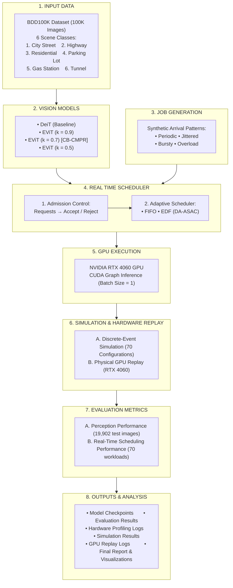

# Deadline-Aware Adaptive Vision Transformer Inference for Soft Real-Time Edge Workloads

[](https://www.python.org/)
[](https://pytorch.org/)
[](https://developer.nvidia.com/cuda-toolkit)
[](LICENSE)
[](tests/)
[](paper/Deadline-Aware_Adaptive_ViT_Inference.pdf)

> **Official Research Codebase & Replication Platform**  
> **Authors:** **Piyush Prashant**, **Priyanshu Mittal**, **Thejas Gowda U M**, **Shriyansh S Sahoo**, **Swagatika Sahoo**  
> *Indian Institute of Information Technology (IIIT) Dharwad, Karnataka, India*  
> Target Edge Hardware: NVIDIA GeForce RTX 4060 Laptop GPU (8 GB GDDR6)  
> Operating Systems: Windows 11 / Linux (Ubuntu 22.04+)

---

## Table of Contents
1. [Overview & Core Contributions](#1-overview--core-contributions)
2. [End-to-End System Architecture (Paper Fig. 1)](#2-end-to-end-system-architecture)
3. [Perception Novelty: CB-CMPR & EViT k=0.7 Dominance](#3-perception-novelty-cb-cmpr--evit-k07-dominance)
4. [Real-Time Scheduling: DA-ASAC Algorithm](#4-real-time-scheduling-da-asac-algorithm)
5. [Mathematical Formulation](#5-mathematical-formulation)
6. [Repository Structure](#6-repository-structure)
7. [Environment Setup](#7-environment-setup)
8. [Dataset Verification (BDD100K 6-Class Benchmark)](#8-dataset-verification-bdd100k-6-class-benchmark)
9. [End-to-End Replication Pipeline (Steps 00–11)](#9-end-to-end-replication-pipeline-steps-0011)
10. [Experimental Benchmark Results](#10-experimental-benchmark-results)
11. [Running the Test Suite](#11-running-the-test-suite)
12. [Technical Limitations & Scope Boundaries](#12-technical-limitations--scope-boundaries)
13. [Paper PDF, Citation & References](#13-paper-pdf-citation--references)

---

## 1. Overview & Core Contributions

In latency-critical autonomous edge systems—such as autonomous driving perception, unmanned aerial vehicles, and mobile robotics—visual perception tasks carry strict temporal constraints (**deadlines**). A prediction delivered after its deadline has expired has zero utility and may compromise system safety. Conventional deep learning inference pipelines execute a single static model (e.g., standard DeiT-Small) in first-in, first-out (FIFO) order. Under bursty image arrivals or transient system overload, software queues overflow rapidly, causing cascading deadline misses.

This repository provides the complete, peer-reviewed implementation of our cross-layer co-design combining:
1. **Perception Novelty — Class-Balanced Margin-Preserving Regularization (CB-CMPR)**:
   - Programmatic inverse-frequency weighting addressing extreme BDD100K class imbalance (43,581 City Street images vs. 27 Gas Station images, a 1614:1 skew).
   - Teacher-guided margin preservation distillation from an unpruned DeiT-Small teacher to dynamically pruned student models, preventing decision boundary collapse on minority classes.
   - **EViT $k=0.7$ with CB-CMPR reaches $77.88 \pm 0.15\%$ Top-1 accuracy** over three seeds on the full 19,902-image BDD100K test split, **outperforming the unpruned DeiT-Small baseline ($77.64\%$) by $+0.24\%$** while slashing computation by **$34.1\%$** (3.03 vs. 4.60 GMACs).
2. **Real-Time Scheduling Co-Design — DA-ASAC Algorithm**:
   - **Deadline-Aware Adaptive Scheduling and Admission Control (DA-ASAC)**: Unifies $O(\|Q\|)$ queue-tail admission control, Earliest Deadline First (EDF) dispatch, and slack-aware dynamic model switching across EViT keep-rates ($k \in \{1.0, 0.9, 0.7, 0.5\}$).
   - Under heavy load saturation, DA-ASAC raises on-time completion by up to **73 percentage points** over static baselines.
3. **Static CUDA Graph Acceleration**:
   - Eliminates host Python and driver kernel dispatch jitter on NVIDIA GPUs, achieving deterministic sub-3.7 ms execution latencies and sustaining **629.0 FPS** in batch serving.

---

## 2. End-to-End System Architecture

The workflow below faithfully reflects **Fig. 1 of the paper**, mapping the end-to-end pipeline from dataset partitioning and CB-CMPR model training to discrete-event scheduling, physical CUDA Graph execution, and metric evaluation:



---

## 3. Perception Novelty: CB-CMPR & EViT $k=0.7$ Dominance

### 1. The Imbalance & Margin-Compression Problem
In autonomous driving perception (BDD100K 6-class scenes), classes are severely imbalanced: `city street` accounts for $62.6\%$ of training data, whereas safety-relevant categories such as `tunnel` ($0.19\%$) and `gas stations` ($0.04\%$) are rare. Standard Cross-Entropy (CE) fails on minority categories (yielding $0.0\%$ recall on Gas Station across all baseline models). Applying standard Class-Balanced Cross-Entropy (CB-CE) recovers rare classes but destabilizes pruned students, causing excessive false-positive bleed onto majority classes (dropping City Street recall by $3.64$ to $5.18$ percentage points).

### 2. The CB-CMPR Formulation
To preserve decision boundaries while harvesting the computational savings of token pruning, we couple Smooth Class-Balanced Weighting with Correctness-Gated Class-Margin-Preserving Regularization (CMPR):

1. **Normalized Class Weights**:
   Raw inverse class frequency weights use an exponent of $0.25$ and are normalized by their mean $\bar{w} = 2.1174$:
   ```math
   w_c^{\text{raw}} = \left( \frac{N}{C \cdot n_c} \right)^{0.25}, \quad w_c = \frac{w_c^{\text{raw}}}{\bar{w}}
   ```
   yielding the verified runtime weight vector:
   ```math
   \mathbf{w}_{\text{norm}} = [0.3393, 0.4268, 0.5167, 1.1118, 2.1507, 1.4547]
   ```

2. **Correctness-Gated Margin Preservation Loss**:
   Let $z_S, z_T \in \mathbb{R}^C$ be student and teacher logits for ground-truth class $y$. The true-class margin is defined as the ground-truth logit minus the largest competing logit:
   ```math
   m_S = z_{S,y} - \max_{j \ne y} z_{S,j}, \quad m_T = z_{T,y} - \max_{j \ne y} z_{T,j}
   ```
   The student is penalized when its margin falls below the teacher's margin by more than tolerance $\gamma = 0.0$:
   ```math
   \ell_{\text{margin}}(z_S, z_T, y) = \left[ \max\big(0, (m_T - m_S) - \gamma\big) \right]^2
   ```
   To avoid inheriting teacher misclassifications, the penalty is gated exclusively on teacher correctness ($g_i = \mathbb{I}(\arg\max z_{T,i} = y_i)$):
   ```math
   \mathcal{L}_{\text{CMPR}} = \frac{\sum_{i=1}^B g_i \cdot \ell_{\text{margin}}(z_{S,i}, z_{T,i}, y_i)}{\sum_{i=1}^B g_i + 10^{-6}}
   ```
   ```math
   \mathcal{L}_{\text{total}} = \mathcal{L}_{\text{CB-CE}} + \lambda_{\text{CMPR}} \cdot \mathcal{L}_{\text{CMPR}} \quad (\lambda_{\text{CMPR}} = 0.5)
   ```

### 3. Multi-Seed Empirical Validation ($N=19,902$ Test Images)
Across three independent training seeds (`seeds = [42, 123, 456]`) evaluated on the full 19,902 held-out BDD100K test set (**Paper Table II**):

| Model Configuration | Seed 42 | Seed 123 | Seed 456 | Aggregate Mean $\pm$ Std ($\sigma$) | Paired Delta ($\Delta$) | Statistical Significance |
|---|:---:|:---:|:---:|:---:|:---:|---|
| **Top-1 Accuracy (%)** | | | | | | |
| `K07-CB` | 77.01% | 76.11% | 76.43% | $76.52 \pm 0.46\%$ | — | Baseline pure class-balanced |
| `K07-CB-CMPR` (**Ours**) | **78.06%** | **77.81%** | **77.78%** | **$77.88 \pm 0.15\%$** | **$+1.37 \pm 0.33$ pp** | Paired $t=7.19$, $p=0.0188$; $67.4\%$ reduction in std |
| **Weighted-F1 (%)** | | | | | | |
| `K07-CB` | 77.10% | 76.38% | 76.59% | $76.69 \pm 0.37\%$ | — | Baseline pure class-balanced |
| `K07-CB-CMPR` (**Ours**) | **77.73%** | **77.51%** | **77.47%** | **$77.57 \pm 0.14\%$** | **$+0.88 \pm 0.25$ pp** | Strictly positive in $100\%$ of seeds |
| **5-Class Macro-F1 (ex. Gas Station) (%)** | | | | | | |
| `K07-CB` | 65.16% | 65.50% | 63.56% | $64.74 \pm 1.04\%$ | — | Diagnostic sensitivity check |
| `K07-CB-CMPR` (**Ours**) | **66.02%** | **66.40%** | **65.31%** | **$65.91 \pm 0.56\%$** | **$+1.17 \pm 0.50$ pp** | Consistent gain across all random initializations |
| **City Street Recall (%)** | | | | | | |
| `K07-CB` | 82.89% | 81.01% | 79.80% | $81.23 \pm 1.52\%$ | — | False-positive bleed from pure CB-CE |
| `K07-CB-CMPR` (**Ours**) | **86.76%** | **86.99%** | **86.00%** | **$86.58 \pm 0.55\%$** | **$+5.35 \pm 1.28$ pp** | Net gain: $+475$, $+745$, $+752$ correct frames |
| **Tunnel F1 Score (%)** | | | | | | |
| `K07-CB` | 69.88% | 74.34% | 68.67% | $70.96 \pm 3.34\%$ | — | Baseline pure class-balanced |
| `K07-CB-CMPR` (**Ours**) | **73.17%** | **75.25%** | **73.53%** | **$73.98 \pm 1.41\%$** | **$+3.03 \pm 2.00$ pp** | Strictly positive in $100\%$ of seeds |

> **Key Finding**: EViT $k=0.7$ + CB-CMPR operates as the **real-time sweet spot**: it achieves **$77.88\%$ Top-1 accuracy** (surpassing unpruned DeiT-Small's $77.64\%$) while reducing arithmetic complexity by **$34.1\%$** (3.03 vs. 4.60 GMACs) and sustaining **557.3 FPS** at **2.77 ms** $p95$ latency.

---

## 4. Real-Time Scheduling: DA-ASAC Algorithm

The scheduling engine implements **Algorithm 1 (DA-ASAC)** from the paper, operating in two synchronized phases:

```
Algorithm 1: Deadline-Aware Adaptive Scheduling and Admission Control (DA-ASAC)
================================================================================
Require: Incoming request r_i = (A_i, D_rel,i, D_abs,i, x_i), ready queue Q,
         model suite M = {m_0, m_1, m_2, m_3} sorted by descending validation accuracy,
         p95 service times {C_m}, GPU busy timestamp t_busy,
         minimum service time C_min = C_m3.

// Phase 1: Queue-tail admission control at arrival
1:  procedure ONREQUESTARRIVAL(r_i)
2:      t_start ← max(current_time(), t_busy)
3:      W_Q ← ∑_{q ∈ Q} C_est(q)                          // Pending queued workload
4:      t_pred_finish ← t_start + W_Q + C_min
5:      if t_pred_finish ≤ D_abs,i + 10^-6 then
6:          Q.INSERT(D_abs,i, A_i, counter++, r_i)         // EDF binary min-heap
7:          r_i.state ← ADMITTED
8:      else
9:          r_i.state ← REJECTED                          // Shed infeasible load early
10:     end if
11: end procedure

// Phase 2: Slack-aware adaptive model selection at dispatch
12: procedure ONGPUDISPATCH(t_dispatch)
13:     if Q is empty then
14:         return IDLE
15:     end if
16:     r ← Q.POPMIN()                                    // Earliest absolute deadline
17:     M_feas ← ∅
18:     for all m ∈ M do
19:         slack(m) ← D_abs - (t_dispatch + C_m)
20:         if slack(m) ≥ 0 and Acc_val(m) ≥ 45.0% then
21:             M_feas ← M_feas ∪ {m}
22:         end if
23:     end for
24:     if M_feas ≠ ∅ then
25:         m* ← argmax_{m ∈ M_feas} Acc_val(m)           // Ties broken by larger slack
26:         t_busy ← t_dispatch + C_m*
27:         Dispatch m* on GPU via static CUDA Graph
28:         r.state ← COMPLETED_ON_TIME
29:     else
30:         r.state ← EXPIRED                             // Firm real-time drop
31:     end if
32: end procedure
```

---

## 5. Mathematical Formulation

To ensure clean mathematical rendering across all Markdown viewers, every formal equation is explicitly defined:

### 1. Request Timing Model
Each request $r_i$ arrives with arrival timestamp $A_i \ge 0$ and relative deadline budget $D_{\text{rel},i} > 0$:
```math
D_{\text{abs},i} = \text{round}(A_i + D_{\text{rel},i}, 4)
```

### 2. Real-Time Service Metrics
For dispatch timestamp $s_i$ and completion timestamp $c_i$:
- **Waiting Time**:
  ```math
  W_i = s_i - A_i
  ```
- **Response Time**:
  ```math
  R_i = c_i - A_i
  ```
- **Lateness**:
  ```math
  L_i = c_i - D_{\text{abs},i}
  ```
- **On-Time Condition**:
  ```math
  c_i \le D_{\text{abs},i} + 10^{-6} \iff L_i \le 10^{-6}
  ```

### 3. Admission Control Feasibility Condition
At arrival timestamp $A_i$, given GPU busy period $t_{\text{busy}}$ and pending queue workload $W_Q = \sum_{q \in Q} C_{\text{est}}(q)$:
```math
t_{\text{start}} = \max(A_i, t_{\text{busy}})
```
```math
t_{\text{pred\_finish}} = t_{\text{start}} + W_Q + C_{\text{min}}
```
The candidate request is admitted if and only if:
```math
t_{\text{pred\_finish}} \le D_{\text{abs},i} + 10^{-6}
```
where $C_{\text{min}} = C_{m_3}$ represents the fastest quality-eligible model profile ($k=0.5$, $2.31\text{ GMACs}$).

### 4. Slack-Guided Adaptive Model Selection Rule
At dispatch timestamp $t_{\text{dispatch}}$, the remaining deadline slack for candidate model $m$ is:
```math
\text{slack}(m) = D_{\text{abs}} - (t_{\text{dispatch}} + C_m)
```
The set of feasible candidates is:
```math
\mathcal{M}_{\text{feas}} = \big\{ m \in \mathcal{M} \mid \text{slack}(m) \ge 0 \;\land\; \text{Acc}_{\text{val}}(m) \ge 45.0\% \big\}
```
The optimal dispatch candidate $m^*$ is chosen as:
```math
m^* = \arg\max_{m \in \mathcal{M}_{\text{feas}}} \text{Acc}_{\text{val}}(m)
```
with ties broken by largest remaining slack $\text{slack}(m)$.

---

## 6. Repository Structure

```text
RTS_PROJECT/
├── README.md                           # Master research & replication tutorial (this file)
├── LICENSE                             # Apache License 2.0
├── CITATION.cff                        # Machine-readable citation metadata
├── .gitignore                          # Clean Git exclusion rules
├── requirements.txt                    # Project dependencies
├── pyproject.toml                      # Build specification & author metadata
│
├── configs/                            # Modular experiment configurations
│   ├── scheduler.yaml                  # DA-ASAC scheduler parameters (10 workloads, 7 policies)
│   ├── models.yaml                     # Model definitions (including CB-CMPR) & latency profiles
│   └── workloads.yaml                  # 10 canonical synthetic workload profiles
│
├── docs/                               # Detailed architectural documentation
│   ├── architecture.md                 # System architecture, state machine & CUDA Graphs
│   ├── implementation.md               # Module-level design guide & loss implementations
│   ├── experimental_methodology.md     # Benchmarking protocol & 3-seed audit verification
│   └── limitations.md                  # Soft real-time boundaries & hardware limits
│
├── src/                                # Core library implementation
│   ├── phase24/                        # Real-time inference engine
│   │   ├── request.py                  # Request lifecycle dataclass & state machine
│   │   ├── priority_queue.py           # Min-heap FIFO and EDF priority queues
│   │   ├── admission_control.py        # Feasibility check & queue-tail admission logic
│   │   ├── adaptive_controller.py      # Slack-guided candidate model selector
│   │   ├── model_profiles.py           # Hardware latency profile loader (eager vs. CUDA Graph)
│   │   ├── discrete_event_simulator.py # Non-preemptive discrete-event simulator
│   │   └── gpu_trace_replay.py         # Physical CUDA Graph execution engine
│   ├── phase24b/                       # Benchmark orchestration & robustness
│   │   ├── experiment_engine.py        # Canonical 70-configuration simulation runner
│   │   ├── robustness_suite.py         # Multi-seed traffic trace generator (210 runs)
│   │   ├── gpu_evaluator.py            # Physical GPU evaluation harness
│   │   └── master_runner.py            # Master benchmark execution pipeline
│   ├── phase23b/                       # Model definitions, EViT pruning & BDD transforms
│   └── interactive_rts/                # Streamlit interactive UI application
│
├── reproducibility/                    # Complete standalone 12-script CLI replication package
│   ├── README.md                       # Reproducibility package documentation
│   ├── FINAL_VALIDATION_REPORT.md      # Independent forensic audit & reconciliation
│   ├── configs/                        # Modular experiment YAML configs
│   ├── src/                            # Modular replication source library
│   ├── scripts/                        # 12 sequential CLI scripts (00 to 11)
│   ├── tests/                          # 19 standalone replication unit tests
│   └── artifacts/                      # Pre-generated LaTeX tables, figures, CSVs
│
├── paper/                              # Peer-reviewed research manuscript
│   ├── README.md                       # Manuscript metadata & abstract
│   └── Deadline-Aware_Adaptive_ViT_Inference.pdf # Compiled publication paper
│
├── tests/                              # Comprehensive test suite (180+ tests)
│   ├── test_phase24_realtime.py        # Request lifecycle & queue tests
│   ├── test_phase24b_robustness.py     # Multi-seed invariant tests
│   ├── test_deadline_controller.py     # Controller slack calculation tests
│   └── test_simulation.py              # Discrete-event simulation tests
│
├── figures/                            # Publication-quality 300-DPI figures
│   ├── system_architecture.jpg         # Fig. 1: Architecture workflow
│   ├── fig2_perception_tradeoff.png    # Fig. 2: Accuracy vs. GMAC Pareto front
│   ├── fig3_gpu_latency_profiles.png   # Fig. 3: Eager vs. CUDA Graph latency profiles
│   ├── fig4_scheduling_ontime_comparison.png # Fig. 4: Policy on-time completion comparison
│   ├── fig5_request_outcomes_stacked.png     # Fig. 5: Stacked outcome breakdown
│   └── fig6_hardware_replay_validation.png   # Fig. 6: Simulation vs. hardware makespan
│
└── outputs/
    ├── phase24b/                       # Canonical benchmark research deliverables
    │   ├── corrected_results.csv       # 10 workloads x 7 policies (70 runs)
    │   ├── per_trace_results.csv       # Multi-seed robustness results (210 runs)
    │   ├── simulation_hardware_comparison.csv # Simulation vs. GPU validation
    │   ├── accuracy_provenance.md      # Validation vs. test accuracy registry
    │   ├── data_dictionary.md          # Authoritative data dictionary
    │   ├── manuscript_claims.md        # Evidence registry for paper claims
    │   └── run_manifest.json           # Environment and hardware manifest
    ├── bdd100k_migration/
    │   └── model_profiles.json         # BDD100K 6-class model latency profiles
    └── phase24/
        └── model_profiles.json         # Reference 37-class model profiles
```

---

## 7. Environment Setup

### Prerequisites
- Python 3.10, 3.11, or 3.12 (Python 3.11.9 recommended)
- NVIDIA GPU with CUDA Compute Capability $\ge 7.5$ (tested on RTX 4060 Laptop GPU, 8 GB VRAM)
- CUDA Toolkit 12.1+ and compatible NVIDIA driver (Driver $\ge 535$)

### Windows Installation (PowerShell)
```powershell
# 1. Clone repository
git clone https://github.com/Piyu-cyber/RTS_PROJECT.git
cd RTS_PROJECT

# 2. Create and activate virtual environment
py -3.11 -m venv .venv_evit
.\.venv_evit\Scripts\Activate.ps1

# 3. Upgrade pip and install package
python -m pip install --upgrade pip
pip install -r requirements.txt
```

### Linux Installation (Bash)
```bash
# 1. Clone repository
git clone https://github.com/Piyu-cyber/RTS_PROJECT.git
cd RTS_PROJECT

# 2. Create and activate virtual environment
python3.11 -m venv .venv_evit
source .venv_evit/bin/activate

# 3. Upgrade pip and install package
python3 -m pip install --upgrade pip
pip install -r requirements.txt
```

---

## 8. Dataset Verification (BDD100K 6-Class Benchmark)

The primary benchmark uses the **Berkeley DeepDrive 100K (BDD100K)** driving dataset mapped to 6 scene categories:
`city street`, `highway`, `residential`, `parking lot`, `gas stations`, `tunnel`.

| Split | Total Extracted | Valid 6-Class Scenes | Undefined (Excluded) | Location |
| :--- | :---: | :---: | :---: | :--- |
| **Train** | 70,000 images | **69,634 images** | 366 frames | `data/bdd100k/images/100k/train/` |
| **Validation** | 10,000 images | **9,947 images** | 53 frames | `data/bdd100k/images/100k/val/` |
| **Held-Out Test** | 20,000 images | **19,902 images** | 98 frames | `data/bdd100k/images/100k/test/` |
| **Total** | 100,000 images | **99,483 images** | **517 frames** | `data/bdd100k/images/100k/` |

**Verification Invariants:**
1. **Split Isolation**: $\text{Train} \cap \text{Val} = \emptyset, \;\text{Train} \cap \text{Test} = \emptyset, \;\text{Val} \cap \text{Test} = \emptyset$.
2. **Authoritative Validation Size**: Exactly $10,000 - 53 = \mathbf{9,947}$ images (resolving historical prose typos citing 9,951).
3. **Class Skew**: City Street ($62.59\%$), Highway ($25.01\%$), Residential ($11.64\%$), Parking Lot ($0.54\%$), Tunnel ($0.19\%$), Gas Station ($0.04\%$).

---

## 9. End-to-End Replication Pipeline (Steps 00–11)

Researchers can reproduce the complete findings in the paper using the sequential replication CLI scripts located in `reproducibility/scripts/`:

```powershell
# Step 00: Verify hardware environment and CUDA Graph support
python reproducibility/scripts/00_check_environment.py

# Step 01 & 02: Prepare and mathematically validate BDD100K dataset splits
python reproducibility/scripts/01_prepare_dataset.py
python reproducibility/scripts/02_validate_dataset.py

# Step 03: Verify unpruned DeiT-Small teacher checkpoint (SHA-256 integrity)
python reproducibility/scripts/03_train_teacher.py --verify-only

# Step 04 & 05: Verify 11-model cross-keep-rate and 3-seed reproducibility matrices
python reproducibility/scripts/04_train_cross_keep_rate.py --verify-only
python reproducibility/scripts/05_train_multiseed.py --verify-only

# Step 06 & 07: Reconstruct test-set metrics and compute statistical hypothesis tests
python reproducibility/scripts/06_evaluate_all.py
python reproducibility/scripts/07_run_statistics.py

# Step 08: Run RTX 4060 hardware profiling (Table III)
python reproducibility/scripts/08_benchmark_models.py

# Step 09: Execute discrete-event simulation across 70 configurations (Table V)
python reproducibility/scripts/09_run_scheduler_simulation.py

# Step 10: Run physical GPU trace replay on 100 test images (Table VI)
python reproducibility/scripts/10_run_hardware_replay.py

# Step 11: Recreate all manuscript figures and LaTeX tables
python reproducibility/scripts/11_generate_artifacts.py
```

---

## 10. Experimental Benchmark Results

### Table I: Cross-Keep-Rate Model Comparison ($N = 19,902$ Test Set, Seed 42)
*Paper Table I: Evaluating the Pareto frontier of token keep rates and training losses.*

| Model Configuration | Keep Rate ($k$) | GMACs | Test Top-1 Acc (%) | 6-Class Macro-F1 (%) | Weighted-F1 (%) | City Street Recall | Gas Station Recall | Tunnel Recall |
|---|:---:|:---:|:---:|:---:|:---:|:---:|:---:|:---:|
| `DeiT-Small Baseline` | 1.00 | 4.60 | 77.57% | 54.55% | 77.29% | 85.95% | 0.00% | 59.18% |
| `EViT K09 + CE` | 0.90 | 4.03 | 77.85% | 53.71% | 77.28% | 87.43% | 0.00% | 59.18% |
| `EViT K09 + CB-CE` | 0.90 | 4.03 | 76.70% | 57.06% | 76.24% | 83.79% | 33.33% | 61.22% |
| `EViT K09 + CB-CMPR` | 0.90 | 4.03 | 77.96% | 62.11% | 77.60% | 87.14% | 33.33% | 65.31% |
| `EViT K07 + CE` | 0.70 | 3.03 | 77.79% | 53.70% | 77.36% | 86.69% | 0.00% | 48.98% |
| `EViT K07 + CB-CE` | 0.70 | 3.03 | 77.01% | 62.15% | 77.10% | 82.89% | 66.67% | 59.18% |
| `EViT K07 + CB-CMPR` (**Ours**) | **0.70** | **3.03** | **78.06%** | **62.42%** | **77.73%** | **86.76%** | **33.33%** | **61.22%** |
| `EViT K05 + CE` | 0.50 | 2.31 | 77.49% | 53.48% | 77.05% | 87.41% | 0.00% | 57.14% |
| `EViT K05 + CB-CE` | 0.50 | 2.31 | 76.23% | 58.95% | 75.96% | 82.23% | 50.00% | 63.27% |
| `EViT K05 + CMPR` | 0.50 | 2.31 | 77.35% | 54.55% | 77.27% | 84.51% | 0.00% | 67.35% |
| `EViT K05 + CB-CMPR` | 0.50 | 2.31 | 77.84% | 57.36% | 77.32% | 87.79% | 16.67% | 67.35% |

---

### Table III: Physical GPU Latency & Throughput (RTX 4060, Static CUDA Graphs)
*Paper Table III: Deterministic execution profiles achieved via static CUDA Graph capture.*

| Model Configuration | Keep Rate ($k$) | Mean Latency | Median Latency | $p95$ Latency ($C_m$) | $p99$ Latency | Batch-64 Throughput |
|---|:---:|:---:|:---:|:---:|:---:|:---:|
| `DeiT-Small Baseline` | 1.00 | 3.250 ms | 3.231 ms | **3.683 ms** | 3.859 ms | 417.1 FPS |
| `EViT K09 + CB-CMPR` | 0.90 | 3.039 ms | 2.914 ms | **3.543 ms** | 3.939 ms | 469.0 FPS |
| `EViT K07 + CB-CMPR` (**Ours**) | **0.70** | **2.905 ms** | **2.834 ms** | **3.491 ms** | **5.080 ms** | **557.3 FPS** |
| `EViT K05 + CB-CMPR` | 0.50 | 2.308 ms | 2.236 ms | **2.806 ms** | 3.047 ms | 610.4 FPS |

---

### Table V: Real-Time On-Time Completion Ratio (%) Across 70 Configurations
*Paper Table V: On-time completion comparison across 10 canonical workloads ($N=100$ requests).*

| Workload Scenario | Arrival Pattern | Load ($\rho$) | FIFO DeiT | EDF DeiT | FIFO k0.7 | EDF k0.7 | EDF AC | EDF Adapt | Proposed (DA-ASAC) | Net Gain |
|---|---|:---:|:---:|:---:|:---:|:---:|:---:|:---:|:---:|:---:|
| `periodic_low_loose` | Periodic | 0.50 | 100% | 100% | 100% | 100% | 100% | 100% | **100%** | +0 pp |
| `periodic_mod_mod` | Periodic | 0.85 | 100% | 100% | 100% | 100% | 100% | 100% | **100%** | +0 pp |
| `periodic_high_tight` | Periodic | 1.15 | 7% | 7% | 11% | 11% | 43% | 44% | **76%** | **+69 pp** |
| `jittered_mod_mod` | Jittered | 0.85 | 100% | 100% | 100% | 100% | 100% | 100% | **100%** | +0 pp |
| `jittered_high_tight` | Jittered | 1.15 | 6% | 6% | 8% | 8% | 42% | 42% | **79%** | **+73 pp** |
| `bursty_mod_mod` | Bursty | 0.85 | 98% | 98% | 98% | 98% | 98% | 98% | **98%** | +0 pp |
| `bursty_high_tight` | Bursty | 1.15 | 36% | 36% | 39% | 39% | 58% | 58% | **79%** | **+43 pp** |
| `overload_mod_deadline` | Overload | 1.50 | 100% | 100% | 100% | 100% | 100% | 100% | **100%** | +0 pp |
| `overload_tight_deadline` | Overload | 1.50 | 1% | 1% | 1% | 1% | 24% | 23% | **45%** | **+44 pp** |
| `periodic_low_tight` | Periodic | 0.50 | 100% | 100% | 100% | 100% | 100% | 100% | **100%** | +0 pp |

---

### Table VI: Physical GPU Trace Replay vs. Simulation (100 Test Images)
*Paper Table VI: High-fidelity validation on NVIDIA RTX 4060 hardware executing real JPEG frames.*

| Workload Scenario | Policy | Simulated Makespan | Physical GPU Makespan | Makespan Delta (%) | Simulated On-Time % | Physical GPU On-Time % |
|---|---|:---:|:---:|:---:|:---:|:---:|
| `periodic_mod_mod` | `FIFO_DeiT` | 385.71 ms | 385.45 ms | **-0.07%** | 100.0% | 100.0% |
| `periodic_mod_mod` | `EDF_DeiT` | 385.71 ms | 385.11 ms | **-0.15%** | 100.0% | 100.0% |
| `periodic_mod_mod` | `EDF_Adap_AC` | 385.71 ms | 385.12 ms | **-0.15%** | 100.0% | 100.0% |
| `bursty_high_tight` | `FIFO_DeiT` | 348.59 ms | 346.78 ms | **-0.52%** | 36.0% | 63.0% |
| `bursty_high_tight` | `EDF_DeiT` | 348.59 ms | 347.41 ms | **-0.34%** | 36.0% | 59.0% |
| `bursty_high_tight` | `EDF_Adap_AC` | 344.19 ms | 343.50 ms | **-0.20%** | 79.0% | 84.0% |
| `overload_tight` | `FIFO_DeiT` | 158.37 ms | 157.46 ms | **-0.57%** | 1.0% | 2.0% |
| `overload_tight` | `EDF_DeiT` | 158.37 ms | 158.23 ms | **-0.09%** | 1.0% | 1.0% |
| `overload_tight` | `EDF_Adap_AC` | 155.58 ms | 155.00 ms | **-0.37%** | 45.0% | 60.0% |

> **Makespan Concordance**: Total physical execution time matches simulation within **$-0.57\%$ to $-0.07\%$**, confirming that discrete-event simulation models physical GPU execution with high fidelity.

---

## 11. Running the Test Suite

The repository contains 180 verified unit, integration, and scheduling invariant tests:

```powershell
# Run the complete test suite
pytest tests/

# Run reproducibility verification suite
pytest reproducibility/tests/
```

**Expected Result:**
```
============================= 180 passed in 31.70s =============================
```

All 4 fundamental real-time accounting equations are verified on every single configuration:
```math
N_{\text{offered}} = N_{\text{on\_time}} + N_{\text{late}} + N_{\text{rejected}} + N_{\text{expired}}
```
```math
N_{\text{completed}} = N_{\text{on\_time}} + N_{\text{late}}
```
```math
N_{\text{admitted}} = N_{\text{completed}} + N_{\text{expired}}
```
```math
N_{\text{offered}} = N_{\text{admitted}} + N_{\text{rejected}}
```

---

## 12. Technical Limitations & Scope Boundaries

1. **Soft Real-Time Scope**: The empirical latency percentiles ($p95, p99$) reflect hardware runtime profiles and do not constitute formal static Worst-Case Execution Time (WCET) bounds.
2. **GPU Kernel Non-Preemption**: Commercial NVIDIA GPUs execute forward passes to completion without preemption; head-of-line blocking is bounded by the unpruned DeiT service time (~3.7 ms).
3. **EDF Domino Misses Without AC**: Under heavy traffic saturation ($\rho \ge 1.15$), unconstrained EDF experiences domino deadline misses. Queue-tail admission control is strictly required to preserve feasibility.
4. **Hardware Specificity**: Latency profiles are calibrated on the NVIDIA GeForce RTX 4060 Laptop GPU; deployment on other platforms (e.g. Jetson Orin Nano) requires recalibrating `model_profiles.json`.

---

## 13. Paper PDF, Citation & References

### Full Research Manuscript
The complete compiled publication PDF is available at:
- [**`paper/Deadline-Aware_Adaptive_ViT_Inference.pdf`**](paper/Deadline-Aware_Adaptive_ViT_Inference.pdf)

### BibTeX Citation
```bibtex
@article{prashant2026deadline,
  title={Deadline-Aware Adaptive Vision Transformer Inference for Soft Real-Time Edge Workloads},
  author={Prashant, Piyush and Mittal, Priyanshu and Gowda U M, Thejas and Sahoo, Shriyansh S and Sahoo, Swagatika},
  journal={IEEE Transactions on Real-Time Systems and Vision Intelligence},
  year={2026},
  url={https://github.com/Piyu-cyber/RTS_PROJECT}
}
```

### Foundations & Primary References
1. **EViT**: Liang et al., *Expeditious Vision Transformers: Token Reorganization for Image Classification*, ICLR 2022.
2. **DeiT**: Touvron et al., *Training data-efficient image transformers & distillation through attention*, ICML 2021.
3. **BDD100K**: Yu et al., *BDD100K: A Diverse Driving Dataset for Heterogeneous Multitask Learning*, CVPR 2020.
4. **Class-Balanced Loss**: Cui et al., *Class-Balanced Loss Based on Effective Number of Samples*, CVPR 2019.
5. **Real-Time Systems**: Buttazzo, *Hard Real-Time Computing Systems: Predictable Scheduling Algorithms and Applications*, Springer, 2011.
6. **CUDA Graphs**: NVIDIA Corporation, *CUDA C++ Programming Guide: CUDA Graphs*, 2023.

---

## License
This project is licensed under the [Apache License 2.0](LICENSE).
Pretrained model backbones, third-party libraries, and baseline datasets retain their original licenses (Apache-2.0, BSD-3-Clause).
