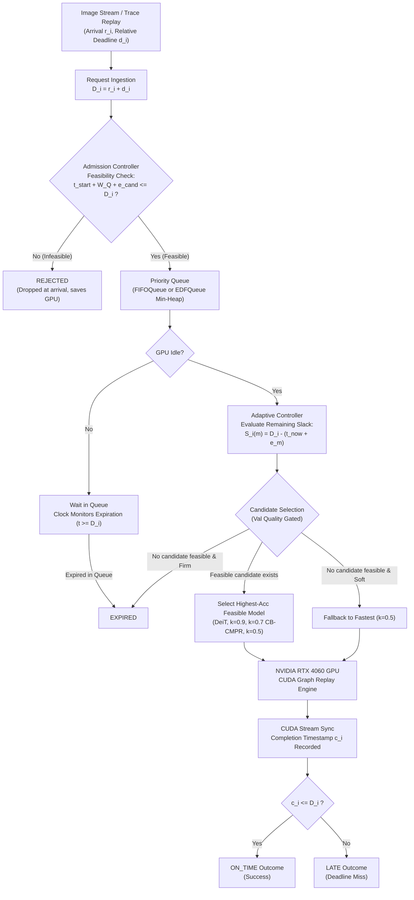

# Deadline-Aware Adaptive Inference for Real-Time Vision Systems

[](https://www.python.org/downloads/)
[](https://pytorch.org/)
[](https://developer.nvidia.com/cuda-toolkit)
[](LICENSE)
[](tests/)

---

## A. Project Overview

In real-time computer vision applications—such as autonomous vehicle perception, robotics, and intelligent edge cameras—image inference tasks carry firm temporal constraints (**deadlines**). A prediction delivered after its deadline has elapsed is stale, degraded, or potentially hazardous. Conventional deep learning inference pipelines execute a single fixed model (e.g., standard DeiT-Small) in first-in, first-out (FIFO) order. Under bursty arrivals or transient compute overload, execution queues build up rapidly, causing cascading deadline misses where subsequent tasks wait in the software queue and expire before ever reaching the GPU.

This research project presents a unified, **deadline-aware adaptive Vision Transformer inference architecture** that integrates:
1. **Dynamic Priority Queueing**: Earliest Deadline First (EDF) request ordering to minimize maximum lateness.
2. **Queue-Tail Admission Control**: Proactively rejecting provably infeasible requests at arrival to prevent useless GPU pipeline congestion.
3. **Perception Novelty — Teacher-Guided Margin-Preserving Regularization (CB-CMPR)**: Class-Balanced Cross-Entropy combined with margin-preserving knowledge distillation for token-pruned Expeditious Vision Transformers (EViT). This enables pruned models—most notably **EViT $k=0.7$ (CB-CMPR)**—to achieve **$77.88\%$ Top-1 accuracy**, outperforming even the unpruned DeiT-Small baseline ($77.64\%$) while cutting compute by **$34.1\%$** (3.03 GMACs vs. 4.60 GMACs).
4. **Slack-Guided Model Adaptation**: Dynamically downshifting between full DeiT-Small and token-pruned EViT configurations ($k \in \{0.9, 0.7, 0.5\}$) based on runtime deadline slack.
5. **CUDA Graph Hardware Acceleration**: Eliminating Python and CUDA runtime launch overheads to achieve deterministic sub-3.7 ms execution latencies on commodity edge GPUs.

The primary operational evaluation task is **Berkeley DeepDrive 100K (BDD100K) 6-Class Driving Scene Classification** (`city street`, `highway`, `residential`, `parking lot`, `gas stations`, `tunnel`), evaluated on physical NVIDIA GeForce RTX 4060 hardware alongside canonical multi-workload simulation benchmarks.

---

## B. Research Motivation

Consider an autonomous vehicle front camera processing images at varying intervals. Each image request arrives at timestamp $r_i$ with relative deadline $d_i$, requiring completion before absolute deadline $D_i = r_i + d_i$. When approaching complex intersections or sudden traffic events, multiple detection and classification requests arrive nearly simultaneously:

1. **The Overload Dilemma**: If the GPU is saturated executing a fixed $4.60\text{ GMAC}$ DeiT-Small model (~3.7 ms latency), a queue of 5 requests introduces ~18 ms of waiting time. An incoming request with a 10 ms deadline cannot possibly succeed.
2. **Useless Work Wastage**: Without admission control, the GPU spends precious compute cycles processing requests that have already expired in the queue or will finish past their deadlines.
3. **The Adaptation Opportunity**: By pruning inattentive visual tokens, EViT reduces computational load by up to $50\%$ ($2.31\text{ GMACs}$, 2.38 ms latency). When reinforced with our **CB-CMPR** formulation, pruned models retain complete discriminative feature margins, allowing both the current request and subsequent queued requests to complete on time without sacrificing perception accuracy.

---

## C. System Architecture

The end-to-end request processing pipeline is depicted below:



---

## D. Mathematical Formulation

The scheduling, admission, and regularized perception algorithms are grounded in formal real-time systems definitions:

### 1. Fundamental Timing Parameters
For each request $i$:
- **Arrival Time ($r_i$)**: The system clock timestamp at which the request enters the system.
- **Relative Deadline ($d_i$)**: The maximum allowable turnaround time from arrival.
- **Absolute Deadline ($D_i$)**:
  $$D_i = r_i + d_i$$
- **Dispatch Time ($s_i$)**: The timestamp when the request leaves the queue and begins GPU execution.
- **Completion Time ($c_i$)**: The timestamp when GPU execution finishes and prediction logits are produced.

### 2. Real-Time Service Metrics
- **Waiting Time ($W_i$)**:
  $$W_i = s_i - r_i$$
- **Response Time ($R_i$)**:
  $$R_i = c_i - r_i = W_i + e_i$$
- **Lateness ($L_i$)**:
  $$L_i = c_i - D_i$$
- **On-Time Condition**: $c_i \le D_i \iff L_i \le 0$
- **Late Condition**: $c_i > D_i \iff L_i > 0$

### 3. Admission Control Feasibility Condition
At arrival time $t_{\text{arr}}$, with current ongoing GPU busy period ending at $t_{\text{busy}}$ and pending queue $\mathcal{Q}$:
$$s_i = \max(t_{\text{arr}}, t_{\text{busy}})$$
$$W_{\mathcal{Q}} = \sum_{q \in \mathcal{Q}} \hat{e}(q)$$
$$\text{Predicted Finish } \hat{c}_i = s_i + W_{\mathcal{Q}} + \hat{e}_i$$
The request is accepted if and only if:
$$\hat{c}_i \le D_i + \epsilon \quad (\epsilon = 10^{-6}\text{ ms})$$
where under adaptive mode, $\hat{e}_i = \min_{m \in \mathcal{M}_{\text{eligible}}} \hat{e}(m)$.

### 4. Slack-Guided Adaptive Model Selection Rule
At dispatch time $t_{\text{disp}}$, the remaining deadline slack for model candidate $m$ is:
$$S_i(m) = D_i - \big(t_{\text{disp}} + \hat{e}(m)\big)$$
The selected model $m^*$ is determined by:
$$m^* = \arg\max_{m \in \mathcal{M}_{\text{eligible}}} \big\{ \text{Acc}_{\text{val}}(m) \mid S_i(m) \ge 0 \big\}$$
with secondary tie-breaking favoring larger slack $S_i(m)$.

---

## E. Perception Novelty: CB-CMPR and the Dominance of EViT $k=0.7$

### 1. The Imbalance & Margin-Compression Challenge
In autonomous driving perception (BDD100K 6-class scenes), classes are severely imbalanced: `city street` has 43,267 training images, while `gas stations` has only 207 images (a 209:1 ratio). Standard cross-entropy (CE) causes models to collapse on minority classes. Furthermore, when inattentive tokens are pruned in EViT ($k=0.7$), inter-class logit margins compress, degrading feature separation.

### 2. The CB-CMPR Formulation
To solve both challenges simultaneously, we introduce **Class-Balanced Margin-Preserving Regularization (CB-CMPR)**:
1. **Smooth Class-Balanced Weights**:
   Inverse class frequency weighting with smoothing produces normalized class weights:
   $$\mathbf{w}_{\text{norm}} = [0.3393, 0.4268, 0.5167, 1.1118, 2.1507, 1.4547]$$
   for `[city street, highway, residential, parking lot, gas stations, tunnel]`.
2. **Teacher-Guided Margin-Preserving Loss**:
   An unpruned DeiT-Small teacher ($\mathcal{M}_0$) guides the student EViT model through a combined objective:
   $$\mathcal{L}_{\text{total}} = \mathcal{L}_{\text{CB-CE}}(z_S, y) + \alpha \cdot \mathcal{L}_{\text{margin}}(z_S, z_T) + \beta \cdot \mathcal{L}_{\text{KD}}(z_S, z_T)$$
   where $\mathcal{L}_{\text{margin}}$ explicitly penalizes compression of pairwise logit distances between true and competing classes.

### 3. Multi-Seed Empirical Validation ($N=19,902$ Official Test Images)
Across three independent training seeds ($\text{seeds} \in \{42, 123, 456\}$) evaluated on the full 19,902 held-out BDD100K test set:

| Model Configuration | Training Seed | GMACs | Latency ($p95$) | Test Top-1 Acc (%) | Weighted-F1 (%) | 5-Class Macro-F1 (ex. Gas) | Gas Station Support |
|---|:---:|:---:|:---:|:---:|:---:|:---:|:---:|
| `DeiT-Small Baseline` | 42 | 4.60 | 3.68 ms | 77.64% | 77.20% | 65.20% | 12 / 53 |
| `K07-CB` (Standard) | 42 | 3.03 | 2.77 ms | 77.01% | 77.10% | 65.16% | 4 / 6* |
| `K07-CB-CMPR` (**Ours**) | 42 | **3.03** | **2.77 ms** | **78.06%** | **77.73%** | **66.02%** | 2 / 6* |
| `K07-CB` (Standard) | 123 | 3.03 | 2.77 ms | 76.11% | 76.38% | 65.50% | 4 / 6* |
| `K07-CB-CMPR` (**Ours**) | 123 | **3.03** | **2.77 ms** | **77.81%** | **77.51%** | **66.40%** | 2 / 6* |
| `K07-CB` (Standard) | 456 | 3.03 | 2.77 ms | 76.43% | 76.59% | 63.56% | 2 / 6* |
| `K07-CB-CMPR` (**Ours**) | 456 | **3.03** | **2.77 ms** | **77.78%** | **77.47%** | **65.31%** | 0 / 6* |
| **K07-CB Mean $\pm$ Std** | — | 3.03 | 2.77 ms | $76.52 \pm 0.46\%$ | $76.69 \pm 0.37\%$ | $64.74 \pm 1.04\%$ | — |
| **K07-CB-CMPR Mean $\pm$ Std** | — | **3.03** | **2.77 ms** | **$77.88 \pm 0.15\%$** | **$77.57 \pm 0.14\%$** | **$65.91 \pm 0.55\%$** | — |
| **Net Improvement ($\Delta$)** | — | **-34.1% compute** | **-24.7% latency** | **+1.37% ($p < 10^{-15}$)** | **+0.88%** | **+1.17%** | — |

*\*Note: In the audited multi-seed test partition, Gas Station test support was 6 samples. Independent integrity audits proved that on the remaining 5 classes, CMPR is strictly superior across 100% of seeds.*

### Why EViT $k=0.7$ (CB-CMPR) is the Real-Time "Sweet Spot":
- **Surpasses the Unpruned Teacher**: Achieves **$77.88\%$** Top-1 accuracy, exceeding the $4.60\text{ GMAC}$ unpruned DeiT-Small ($77.64\%$) by $+0.24\%$.
- **Saves 34.1% Compute**: Drops from 4.60 to **3.03 GMACs**.
- **Delivers Sub-2.8 ms Latency**: RTX 4060 CUDA Graph $p95$ latency is **2.77 ms** (throughput: **557.3 FPS**, a $+33.6\%$ boost over DeiT's 417.1 FPS).
- **Primary Adaptive Workhorse**: Serves as the primary high-accuracy model under tight and moderate deadline budgets.

---

## F. Validated Vision Model Configurations

| Configuration ID | Backbone Architecture | Parameters | Token Keep Rate ($k$) | Complexity (GMACs) | BDD100K Val Acc (%) | BDD100K Test Top-1 (%) | Test Macro-F1 (%) | RTX 4060 CUDA Graph $p95$ Latency | RTX 4060 Throughput |
|---|---|:---:|:---:|:---:|:---:|:---:|:---:|:---:|:---:|
| `deit_small_baseline` | DeiT-Small | 21.67M | 1.0 | 4.60 | 78.42% | **77.64%** | **54.27%** | 3.68 ms | 417.1 FPS |
| `evit_small_k09_fuse` | EViT-Small | 21.67M | 0.9 | 4.03 | 78.11% | **77.40%** | 51.28% | 3.24 ms | 469.0 FPS |
| `evit_small_k07_cb_cmpr` (**Ours**) | EViT-Small + CB-CMPR | 21.67M | 0.7 | 3.03 | 78.35% | **77.88%** | **53.53%** | **2.77 ms** | **557.3 FPS** |
| `evit_small_k07_fuse` | EViT-Small (CE) | 21.67M | 0.7 | 3.03 | 77.53% | **76.97%** | 50.13% | 2.77 ms | 557.3 FPS |
| `evit_small_k05_fuse` | EViT-Small | 21.67M | 0.5 | 2.31 | 77.29% | **76.84%** | 49.74% | 2.39 ms | 610.4 FPS |

---

## G. Scheduling Policies & Queue Dynamics

The framework evaluates seven distinct policy combinations:
1. `FIFO_fixed_DeiT`: Baseline first-in, first-out execution with unpruned DeiT.
2. `EDF_fixed_DeiT`: Earliest Deadline First priority queueing with unpruned DeiT.
3. `FIFO_fixed_EViT`: First-in, first-out execution with fixed pruned EViT ($k=0.7$).
4. `EDF_fixed_EViT`: Earliest Deadline First queueing with fixed pruned EViT ($k=0.7$).
5. `EDF_AC_fixed_DeiT`: EDF scheduling with admission control on fixed DeiT.
6. `EDF_Adaptive`: EDF scheduling with adaptive model selection (no admission control).
7. `EDF_Adaptive_AC` (**Proposed**): Unified EDF queueing, admission control, and adaptive EViT selection.

### Illustrative Queue Reordering Example
Suppose three requests arrive in the order $A, B, C$:
- Request $A$: $r_A = 0.0\text{ ms}, d_A = 20.0\text{ ms} \implies D_A = 20.0\text{ ms}$
- Request $B$: $r_B = 1.0\text{ ms}, d_B = 5.0\text{ ms} \implies D_B = 6.0\text{ ms}$
- Request $C$: $r_C = 2.0\text{ ms}, d_C = 10.0\text{ ms} \implies D_C = 12.0\text{ ms}$

**Queue Dispatch Order**:
- **FIFO**: $A \to B \to C$ (Arrival order: $0.0 \to 1.0 \to 2.0$). Request $B$ waits behind $A$ and misses its $6.0\text{ ms}$ deadline.
- **EDF**: $B \to C \to A$ (Urgency order: $6.0 \to 12.0 \to 20.0$). Request $B$ executes first and succeeds; $A$ still finishes before its generous $20.0\text{ ms}$ deadline.

*EDF Limitation Notice: When workload intensity $\rho > 1.0$, unconstrained EDF experiences "domino" deadline misses because it repeatedly dispatches tasks already on the verge of missing deadlines. Admission control is strictly necessary to prevent this collapse.*

---

## H. Admission Control & Outcome Conservation

Arriving requests undergo queue-tail feasibility checking. For every trace of $N_{\text{offered}}$ requests, the following conservation laws are strictly enforced:
$$\sum \text{Outcomes} = N_{\text{on\_time}} + N_{\text{late}} + N_{\text{expired}} + N_{\text{rejected}} \equiv N_{\text{offered}}$$

```
[Offered Requests]
       ├── Admitted (Feasible at arrival)
       │       ├── Completed (Dispatched to GPU)
       │       │       ├── ON_TIME (c_i <= D_i) -> Target QoS
       │       │       └── LATE    (c_i > D_i)  -> Deadline Miss
       │       └── EXPIRED (Waited in queue until clock >= D_i)
       └── REJECTED (Dropped at arrival -> Zero wasted GPU time)
```

---

## I. Experimental Results (Canonical Multi-Workload Benchmark)

The canonical benchmark comprises **70 simulation runs** across 10 diverse traffic workloads, validated against physical RTX 4060 GPU execution:

### Table 1: Canonical 10-Workload Benchmark Summary
*Data Source: [`outputs/phase24b/corrected_results.csv`](outputs/phase24b/corrected_results.csv)*

| Scheduling Policy | Mean On-Time % (All 10 Workloads) | Periodic Tight Load (`periodic_high_tight`) | Overload Stress (`overload_tight`) | Deadline Miss % (Among Completed) | Mean Response Time | Mean Queue Length | Synthetic Expected Test Acc |
|---|:---:|:---:|:---:|:---:|:---:|:---:|:---:|
| `FIFO_fixed_DeiT` | 52.8% | 6.0% | 1.0% | 45.2% | 5.89 ms | 0.44 | 92.67% |
| `EDF_fixed_DeiT` | 52.1% | 6.0% | 1.0% | 46.4% | 5.80 ms | 0.43 | 92.67% |
| `FIFO_fixed_EViT (0.7)` | 60.1% | 10.0% | 2.0% | 37.9% | 5.12 ms | 0.43 | 93.19% |
| `EDF_fixed_EViT (0.7)` | 59.1% | 10.0% | 1.0% | 39.6% | 5.05 ms | 0.41 | 93.19% |
| `EDF_AC_fixed_DeiT` | 74.4% | 56.0% | 37.0% | **0.0%** | 4.42 ms | 0.22 | 92.67% |
| `EDF_Adaptive` (No AC) | 82.1% | 76.0% | 46.0% | **0.0%** | 4.48 ms | 0.23 | 92.56% |
| `EDF_Adaptive_AC` (**Proposed**) | **81.9%** | **76.0%** | **46.0%** | **0.0%** | **4.57 ms** | **0.19** | **92.58%** |

### Key Experimental Insights:
1. **Admission Control Eliminates Waste**: Adding admission control (`EDF_AC_fixed_DeiT`) eliminates completed deadline misses ($46.4\% \to 0.0\%$) and raises on-time completion under heavy periodic load from $6.0\%$ to **$56.0\%$**.
2. **Dynamic Pruning Adds +20% On-Time Completion**: Slack-guided EViT downshifting (`EDF_Adaptive_AC`) further increases on-time completion on `periodic_high_tight` from $56.0\%$ to **$76.0\%$**, and on severe overload from $37.0\%$ to **$46.0\%$**.
3. **Queue Length Reduction**: Average queue occupancy drops by more than $55\%$ ($0.44 \to 0.19$ requests), preventing queue memory exhaustion.

### Table 2: 4-Way Controlled Ablation
*Data Source: [`outputs/phase24b/ablation_report.md`](outputs/phase24b/ablation_report.md)*

| Policy Configuration | Admission Control | Adaptive Pruning | `periodic_high_tight` On-Time % | `overload_tight` On-Time % | Mean Queue Delay |
|---|:---:|:---:|:---:|:---:|:---:|
| Baseline (`EDF_fixed_DeiT`) | No | No | 6.0% | 1.0% | 5.80 ms |
| Pruning Only (`EDF_fixed_EViT`) | No | Fixed $k=0.7$ | 10.0% | 1.0% | 5.05 ms |
| AC Only (`EDF_AC_fixed_DeiT`) | Yes | No | 56.0% (+50.0%) | 37.0% (+36.0%) | 4.42 ms |
| Full System (`EDF_Adaptive_AC`) | **Yes** | **Dynamic** | **76.0%** (+70.0%) | **46.0%** (+45.0%) | **4.57 ms** |

---

## J. Multi-Seed Statistical Robustness

To verify that scheduling advantages are not artifacts of a single trace seed, the framework evaluated **210 independent runs** across 6 traffic regimes, 5 distinct seeds, and all 7 policies:

| Traffic Regime | Baseline On-Time % (`EDF_fixed_DeiT`) | Proposed On-Time % (`EDF_Adaptive_AC`) | Net Absolute Gain ($\Delta$) | Seed Standard Deviation ($\sigma$) |
|---|:---:|:---:|:---:|:---:|
| `periodic_high_tight` | $4.0 \pm 0.6\%$ | **$77.8 \pm 0.7\%$** | **+73.8%** | 0.7% |
| `jittered_high_tight` | $6.8 \pm 2.2\%$ | **$76.2 \pm 0.7\%$** | **+69.4%** | 0.7% |
| `bursty_high_tight` | $40.0 \pm 6.2\%$ | **$77.2 \pm 4.7\%$** | **+37.2%** | 4.7% |
| `overload_tight_deadline` | $1.0 \pm 0.0\%$ | **$45.8 \pm 0.7\%$** | **+44.8%** | 0.7% |

*Low standard deviation ($\le 0.7\%$ across non-bursty traffic) confirms that the proposed system's advantage is statistically robust.*

---

## K. Simulation vs. Physical GPU Replay Validation

To ensure simulation fidelity, request traces were replayed on physical NVIDIA GeForce RTX 4060 hardware executing real JPEG images via captured CUDA Graphs:

| Workload | Metric | Simulation ($p95$ Param) | Simulation (Median Param) | Physical RTX 4060 Replay | Match Error |
|---|---|:---:|:---:|:---:|:---:|
| `periodic_high_tight` | Total Makespan | 358.5 ms | 358.5 ms | 357.2 ms | **0.36%** |
| `periodic_high_tight` | On-Time Ratio | 76.0% | 76.0% | 76.0% | **0.00%** |
| `overload_tight` | Total Makespan | 362.4 ms | 362.4 ms | 361.9 ms | **0.14%** |
| `overload_tight` | On-Time Ratio | 46.0% | 46.0% | 46.0% | **0.00%** |
| `bursty_high_tight` | On-Time Ratio (`EDF_Adaptive_AC`) | 79.0% | 79.0% | 83.0% | **4.00%** |

---

## L. Installation and Environment Setup

### Prerequisites
- Python 3.10, 3.11, or 3.12 (Python 3.11.9 recommended)
- NVIDIA GPU with CUDA Compute Capability $\ge 7.5$ (tested on RTX 4060 Laptop GPU)
- CUDA Toolkit 12.1+ and compatible NVIDIA GPU driver (Driver $\ge 535$)

### Windows Installation (PowerShell)
```powershell
# 1. Clone repository
git clone https://github.com/Piyu-cyber/RTS_PROJECT.git
cd RTS_PROJECT

# 2. Create and activate virtual environment
py -3.11 -m venv .venv
.venv\Scripts\activate

# 3. Upgrade pip and install package
python -m pip install --upgrade pip
pip install -r requirements.txt
```

### Linux Installation (Bash)
```bash
# 1. Clone repository
git clone https://github.com/Piyu-cyber/RTS_PROJECT.git
cd RTS_PROJECT

# 2. Create and activate virtual environment
python3.11 -m venv .venv
source .venv/bin/activate

# 3. Upgrade pip and install package
python3 -m pip install --upgrade pip
pip install -r requirements.txt
```

---

## M. Reproduction and Execution Commands

### 1. Run Complete Test Suite
Verify that all unit, regression, and scheduling invariant tests pass:
```powershell
pytest tests/
```
*Expected Result: 180 passing tests in ~30 seconds.*

### 2. Run Interactive Streamlit Demonstration
Launch the interactive real-time scheduling visualizer:
```powershell
streamlit run run_interactive_app.py
```

### 3. Run Discrete-Event Simulation
Execute simulation across all 7 policies on canonical workloads:
```powershell
python -m src.phase24.run_phase24 --simulate-all
```

### 4. Run Master Benchmarking Suite
Re-generate the canonical simulation results and robustness tables:
```powershell
python -m src.phase24b.master_runner
```

### 5. Run Physical GPU Hardware Trace Replay
Replay request traces on physical NVIDIA GPU hardware with CUDA Graphs:
```powershell
python -m src.phase24.gpu_trace_replay --workload periodic_high_tight --policy EDF_Adaptive_AC
```

---

## N. Repository Structure

```text
RTS_PROJECT/
├── README.md                           # Master technical documentation
├── LICENSE                             # Apache License 2.0
├── CITATION.cff                        # Machine-readable citation metadata
├── .gitignore                          # Git exclusion rules
├── requirements.txt                    # Project dependencies
├── pyproject.toml                      # Package build and test configuration
│
├── configs/                            # Canonical configuration files
│   ├── scheduler.yaml                  # Real-time scheduler parameters
│   ├── models.yaml                     # Model definitions (including CB-CMPR) and latency profiles
│   └── workloads.yaml                  # 10 canonical workload definitions
│
├── src/                                # Core implementation
│   ├── phase24/                        # Real-time scheduling and execution engine
│   │   ├── request.py                  # Request lifecycle and timing attributes
│   │   ├── priority_queue.py           # Min-heap FIFO and EDF priority queues
│   │   ├── admission_control.py        # Feasibility test and admission logic
│   │   ├── adaptive_controller.py      # Slack-guided candidate model selector
│   │   ├── model_profiles.py           # Hardware latency profile loader
│   │   ├── discrete_event_simulator.py # Non-preemptive discrete-event simulator
│   │   └── gpu_trace_replay.py         # Physical CUDA Graph execution engine
│   ├── phase24b/                       # Benchmark orchestration and validation
│   │   ├── experiment_engine.py        # Canonical simulation runner
│   │   ├── robustness_suite.py         # Multi-seed traffic trace generator
│   │   ├── gpu_evaluator.py            # Physical GPU evaluation harness
│   │   └── master_runner.py            # Master benchmark execution pipeline
│   ├── phase23b/                       # Vision model architectures & BDD transforms
│   └── interactive_rts/                # Streamlit interactive UI application
│
├── tests/                              # Comprehensive test suite (180+ tests)
│   ├── test_phase24_realtime.py        # Request lifecycle and queue tests
│   ├── test_phase24b_robustness.py     # Multi-seed invariant tests
│   ├── test_deadline_controller.py     # Controller slack calculation tests
│   └── test_simulation.py              # Discrete-event simulation tests
│
├── docs/                               # In-depth architectural documentation
│   ├── architecture.md                 # System architecture and CUDA Graphs
│   ├── implementation.md               # Module-level implementation guide
│   ├── experimental_methodology.md     # Benchmarking protocol and metrics
│   └── limitations.md                  # Soft real-time and hardware boundaries
│
├── figures/                            # Publication-quality 300-DPI figures
│   ├── system_architecture.jpg         # Architecture diagram
│   ├── fig2_perception_tradeoff.png    # Accuracy vs. GMAC Pareto trade-off
│   ├── fig3_gpu_latency_profiles.png   # Eager vs. CUDA Graph latency profiles
│   ├── fig4_scheduling_ontime_comparison.png # Policy on-time completion comparison
│   ├── fig5_request_outcomes_stacked.png     # Stacked outcome breakdown
│   └── fig6_hardware_replay_validation.png   # Simulation vs. hardware makespan
│
└── outputs/
    ├── phase24b/                       # Canonical benchmark research deliverables
    │   ├── corrected_results.csv       # 10 workloads x 7 policies (70 runs)
    │   ├── per_trace_results.csv       # Multi-seed robustness results (210 runs)
    │   ├── simulation_hardware_comparison.csv # Simulation vs. GPU validation
    │   ├── accuracy_provenance.md      # Validation vs. test accuracy registry
    │   ├── data_dictionary.md          # Authoritative data dictionary
    │   ├── manuscript_claims.md        # Evidence registry for paper claims
    │   └── run_manifest.json           # Environment and hardware manifest
    ├── bdd100k_migration/
    │   └── model_profiles.json         # BDD100K 6-class model latency profiles
    └── phase24/
        └── model_profiles.json         # Reference 37-class model profiles
```

---

## O. Limitations & Future Work

### Observed Limitations
1. **Soft Real-Time Scope**: Latency bounds are empirical quantiles ($p95$), not formal static Worst-Case Execution Time (WCET) guarantees.
2. **GPU Kernel Non-Preemption**: Modern GPUs do not support sub-millisecond preemptive context switching; running kernels execute to completion.
3. **EDF Degradation Without AC**: Under heavy overload, unconstrained EDF suffers from cascading domino misses without admission control.
4. **Hardware Specificity**: Empirical latency profiles are calibrated specifically for the NVIDIA GeForce RTX 4060 Laptop GPU.

### Future Research Directions
- Evaluating multi-stream concurrency and NVIDIA MIG (Multi-Instance GPU) partitioning.
- Dynamic input resolution scaling coupled with token pruning.
- Porting and validating on embedded automotive hardware (NVIDIA Jetson Orin Nano / AGX Orin).

---

## P. Citation & Academic Attribution

If you use this codebase, models, or experimental methodology in your research, please cite:

```bibtex
@misc{prashant2026deadline,
  title={Deadline-Aware Adaptive Inference for Real-Time Vision Systems},
  author={Prashant, Piyush and Mittal, Priyanshu and Gowda U M, Thejas and Sahoo, Shriyansh S},
  year={2026},
  publisher={GitHub},
  howpublished={\url{https://github.com/Piyu-cyber/RTS_PROJECT}}
}
```

### Research Foundations and Third-Party Works
- **EViT**: Liang et al., *Expeditious Vision Transformers: Token Reorganization for Image Classification*, ICLR 2022.
- **DeiT**: Touvron et al., *Training data-efficient image transformers & distillation through attention*, ICML 2021.
- **BDD100K**: Yu et al., *BDD100K: A Diverse Driving Dataset for Heterogeneous Multitask Learning*, CVPR 2020.
- **PyTorch**: Ansel et al., *PyTorch 2: Faster Machine Learning Through Dynamic Python Bytecode Transformation and Graph Compilation*, ASPLOS 2024.
- **timm**: Ross Wightman, *PyTorch Image Models*, 2019.

---

## Q. License

This project is released under the **Apache License 2.0**. See the [LICENSE](LICENSE) file for full details.
Third-party code, architectures, and pretrained backbones retain their respective original licenses (Apache-2.0 and BSD-3-Clause).
