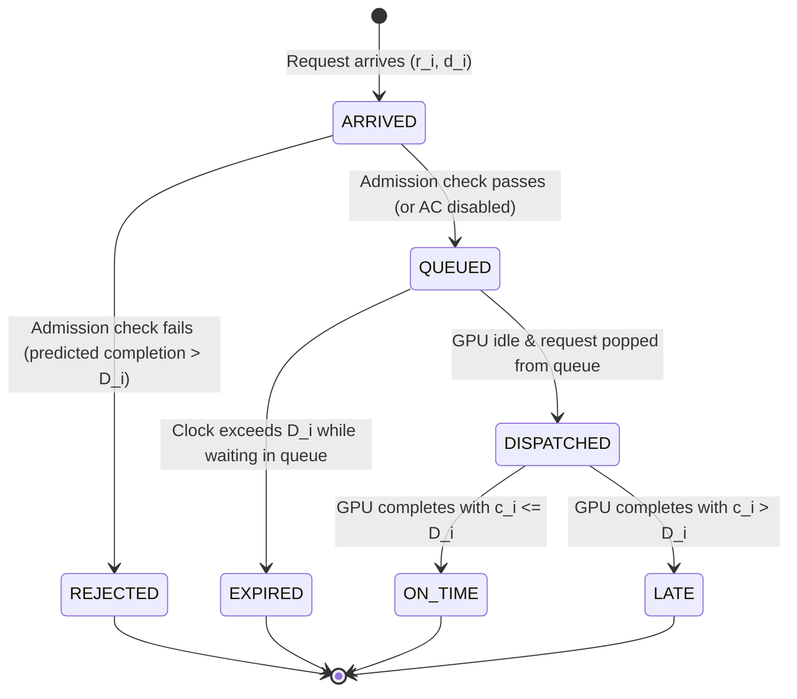
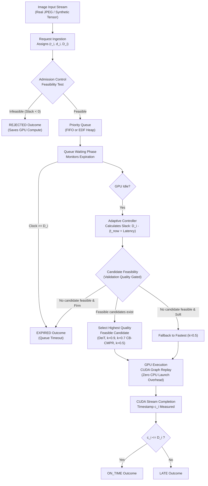
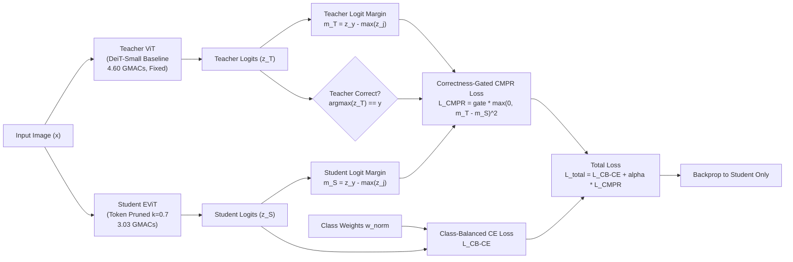

# System Architecture

## 1. Overview and Core Philosophy

In soft real-time vision inference, processing an image correctly but delivering the result past its deadline renders the prediction degraded or useless. Conventional inference engines run a fixed neural network model (e.g., full DeiT-Small) in first-come, first-served order. When incoming request arrival rates exceed the GPU processing capacity, requests accumulate in the software queue. Under high queueing delay, subsequent requests miss their deadlines even if the GPU execution itself takes only a few milliseconds.

This system addresses queue-induced deadline collapse through a unified real-time architecture:
1. **Queue-Aware Feasibility Gating (Admission Control)**: Drops infeasible requests upon arrival to prevent useless work from saturating GPU pipelines.
2. **Dynamic Priority Queueing (Earliest Deadline First)**: Dispatches requests in order of absolute deadline urgency rather than arrival time.
3. **Regularized Pruned Perception (CB-CMPR)**: Class-Balanced Cross-Entropy with Correctness-Gated Margin-Preserving Regularization, enabling pruned models—most notably EViT $k=0.7$—to retain high discriminative accuracy ($77.88\%$ Top-1) while reducing compute by $34.1\%$.
4. **Slack-Guided Model Adaptation (Adaptive EViT Selection)**: Evaluates remaining deadline slack at the moment of GPU dispatch and dynamically selects the highest-accuracy Vision Transformer variant that can complete before the deadline.

---

## 2. Request Lifecycle State Machine

Each incoming inference request moves through a formal lifecycle state machine:

### Formal States:
- **`ARRIVED`**: Request has been initialized with arrival timestamp $r_i$ and relative deadline $d_i$. Absolute deadline is $D_i = r_i + d_i$.
- **`QUEUED`**: Request is accepted and enqueued into the priority queue (FIFO or EDF).
- **`DISPATCHED`**: Request is dequeued by the scheduler, bound to a specific Vision Transformer configuration, and launched on the GPU stream.
- **`TERMINATED`**: Request has finished its lifecycle. Exactly one terminal outcome is assigned.

### Terminal Outcomes:
- **`ON_TIME`**: Dispatched and completed with completion timestamp $c_i \le D_i$.
- **`LATE`**: Dispatched and completed with $c_i > D_i$.
- **`EXPIRED`**: Dropped from the queue before dispatch because $t_{\text{now}} \ge D_i$ (or insufficient slack for even the fastest model under firm semantics).
- **`REJECTED`**: Dropped at arrival by admission control because estimated queuing and execution latency exceeds $D_i$.

---

## 3. End-to-End Inference Pipeline

The architectural pipeline connects request generation, scheduling, neural network execution, and outcome accounting:

---

## 4. CUDA Graph Acceleration Architecture

PyTorch kernel launch overhead in eager execution mode introduces between 8 ms and 15 ms of host-to-device synchronization and kernel scheduling jitter per inference call. In real-time workloads where deadlines range from 5 ms to 20 ms, eager launch overhead consumes up to 80% of the entire timing budget.

To eliminate host launch jitter, the system encapsulates each Vision Transformer configuration inside a static `CUDAGraphRunner`:
- **Static Memory Buffers**: Pre-allocates fixed input tensor (`1 x 3 x 224 x 224`) and output logit buffer (`1 x C`) in GPU device memory.
- **Warmup Execution**: Warms up model weights and PyTorch runtime on dedicated CUDA streams for 15 iterations.
- **Graph Capture**: Captures the entire forward-pass kernel sequence into a static hardware graph.
- **Replay Execution**: At runtime, image data is copied into the pre-allocated static buffer and `graph.replay()` is triggered.

This reduces median inference latency on the NVIDIA RTX 4060 GPU from ~13.1 ms (eager) to **3.15 ms** (CUDA Graph) for DeiT-Small, and down to **2.38 ms** for EViT $k=0.5$, providing predictable execution profiles required for real-time scheduling.

---

## 5. Regularized Perception Architecture: CB-CMPR

To overcome class imbalance and logit-margin compression caused by token pruning, the training pipeline couples Smooth Class-Balanced Cross-Entropy with Correctness-Gated Margin-Preserving Regularization:

This ensures that the pruned student ($k=0.7$) retains the discriminative decision boundaries of the unpruned teacher, yielding $77.88\%$ Top-1 accuracy while operating in just $2.77\text{ ms}$ on the GPU.
